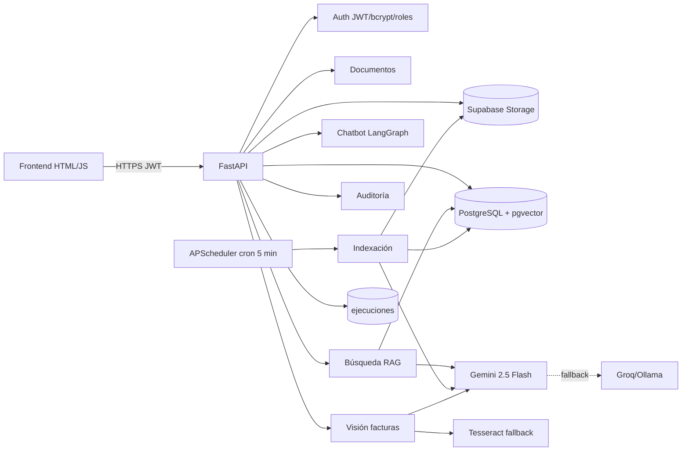

# Documento de diseño — Tercer Corte

**Proyecto:** Gestión documental con IA (migración a automatización propia + visión)
**Asignatura:** Desarrollo de Aplicaciones Empresariales
**Ruta elegida:** A — código propio (Python + FastAPI)
**Caso de visión:** Lectura de facturas/recibos
**Despliegue:** Render + Supabase

---

## 1. Contexto y motivo de la migración

En los cortes anteriores el aplicativo dependía de n8n en la nube (3 workflows: indexación masiva, API de gestión y agente RAG) y de Google Sheets/Drive. El plan gratuito de n8n cloud dejó de estar disponible y los flujos se convierten ahora en la **especificación** de lo que se programa. Este documento es la entrega de la semana 1.

## 2. Inventario de flujos n8n (especificación)

| Flujo | Disparador | Pasos | Servicios externos | Resultado |
|---|---|---|---|---|
| WF2 API gestión | Webhook POST | Login (SHA-256), validación de sesión, switch de acciones | Google Sheets, Google Drive, Qdrant | JSON para la página (documentos, repos, token, url) |
| WF1 Indexación | Cron 5 min + manual | Buscar archivos en Drive, filtrar nuevos, descargar, indexar en Qdrant, extraer texto, clasificar/resumir con Gemini, registrar estado | Drive, Sheets, Qdrant, Gemini | Documentos con estado `procesado` y campos `categoria`, `resumen`, `datos` |
| WF3 Agente RAG | Webhook POST | Validar sesión, `buscar` (embeddings + Qdrant top-k) o `consultar` (top-k + Gemini) | Sheets, Qdrant, Gemini | `{resultados}` o `{respuesta, fuentes}` |

Acciones de WF2: `login`, `listar`, `subir`, `eliminar`, `reintentar`, `descargar`, `crear_repo`, `buscar`, `consultar`.

## 3. Arquitectura resultante

## 4. Stack

Python 3.12 + FastAPI, SQLAlchemy, PostgreSQL (Supabase) + pgvector, Supabase Storage, Gemini free tier (chat/visión/embeddings), LangChain/LangGraph, APScheduler, Tesseract, JWT + bcrypt, Render (Web Service Docker + Cron Job).

## 5. Módulo de visión (facturas)

Entrada: foto o PDF desde web, celular o chatbot. Pipeline: validación → guardado en Storage con hash, ACL y auditoría → extracción con Gemini 2.5 Flash multimodal (JSON: proveedor, fecha, NIT, items, total, confianza) → si confianza ≥ 0.85 se crea el registro; si no, pantalla de confirmación → al confirmar se inserta en `facturas` y se dispara el proceso correspondiente. Plan B: Tesseract OCR + LLM para estructurar; si falla, se guarda como `por_confirmar` y se avisa al usuario.

Pruebas: 20 facturas reales con matriz de acierto por campo y umbral de confianza documentado.

## 6. Seguridad y protección de datos

- JWT con expiración, bcrypt, roles (admin/usuario), variables de entorno (`.env`).
- Ley 1581: finalidad, autorización, retención, cifrado; opción de procesar localmente; registro de auditoría de las acciones de la IA.
- Plan B ante agotamiento de cuota de Gemini: fallback Groq/Ollama + cola de reintento.

## 7. Despliegue

Supabase (PostgreSQL + pgvector + Storage) + Render (Web Service Docker con Tesseract + Cron Job cada 5 min). Variables de entorno en Render; CORS restringido al dominio del frontend.

## 8. Próximos pasos (semanas 2-5)

- Semana 2: motor con ≥50% de flujos + chatbot migrado.
- Semana 3: visión con imágenes reales.
- Semana 4: integración + 20 pruebas + seguridad + despliegue.
- Semana 5: sustentación y documentación.
